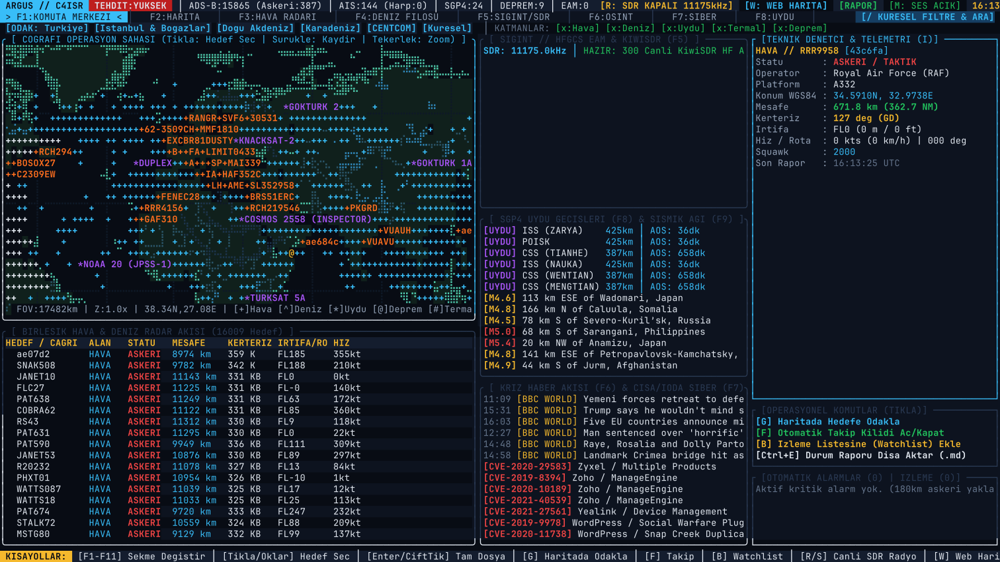
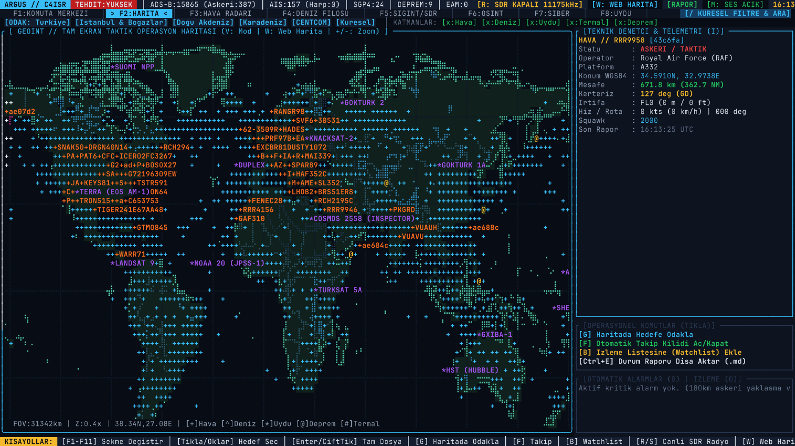
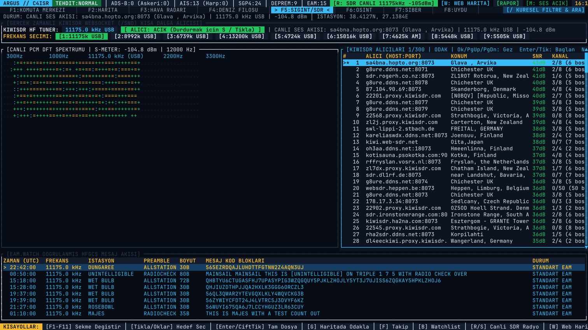

# Project Sentinel (`argus-osint`)

**Project Sentinel**, Rust (`ratatui v0.29` + `tokio`) ile gelistirilmis, gercek zamanli acik kaynak istihbarat (**OSINT**), sinyal istihbarati (**SIGINT / KiwiSDR**), kuresel hava/deniz trafik takibi (**ADS-B / AIS**), uydu yorunge izleme (**SGP4**) ve jeofizik/siber izleme modullerini tek bir **C4ISR Durumsal Farkindalik Konsolu** icinde birlestiren canli izleme istasyonudur.

Sistemde sentetik veri uretimi veya yapay simulasyon bulunmaz; tum telemetri dogrudan kuresel kamuya acik veri kaynaklarindan, WebSocket akislarindan ve gercek KiwiSDR kisa dalga alicilarindan beslenir.

---

## Ekran Goruntuleri

### 1. C4ISR Komuta Merkezi (`F1`)
> 3 sutunlu operasyon kokpiti: Natural Earth haritasi + yakinlik radari, canli HFGCS EAM / SGP4 / USGS / OSINT / CISA akislari ve secili hedef denetci paneli.



### 2. Tam Ekran Kuresel Vektor ve Raster Harita (`F2`)
> Official **Natural Earth** 1:50m kuresel kiyilar, ulke sinirlari ve goller + 1:10m bolgesel detay katmani + `720x360` kara/deniz maskesi uzerinde canli hedefler.



### 3. Kuresel & CENTCOM Hava Sahasi Radari (`F3`)
> Cok kaynakli kuresel ADS-B taramasi (`CENTCOM`, `TR/EUCOM`, `AFRICOM`, `INDOPACOM`, `NORTHCOM`, `SOUTHCOM` AOR siniflandirmasi), askeri/ISR heuristik tespiti, GPS jamming (`NIC < 5`) ve mini-harita korelasyonu.


### 4. Gercek Zamanli KiwiSDR HF Radyo & DFT Spektrum Selalesi (`F5`)
> `rx.linkfanel.net` uzerinden 300 canli 0-30 MHz KiwiSDR dugumunde gezinme, `/SND` WebSocket PCM ses dinleme, canli 60-bin Ayrık Fourier Donusumu (DFT) spektrum selalesi ve `eam.watch` HFGCS EAM akisi.



### 5. CelesTrak SGP4 Uydu Polar Radar Skobu (`F8`)
> CelesTrak GP TLE verilerinden anlik SGP4 yorunge propagasyonu (ISS, Tiangong, Gokturk, Turksat, Starlink vb.), Azimuth/Elevation polar radar skobu ve AOS/LOS gecis sayaci.


---

## Temel Ozellikler ve Veri Kaynaklari

| Disiplin | Kisayol | Canli Veri Kaynaklari & Protokoller |
| :--- | :--- | :--- |
| **GEOINT (Harita)** | `F2` | Natural Earth `1:50m` & `1:10m` vektor harita, `720x360` kara/deniz maskesi, `http://127.0.0.1:8090` Leaflet Web Harita |
| **AIRINT (Hava)** | `F3` / `H` | Coklu kaynak kuresel ADS-B (`opendata.adsb.fi`, `api.adsb.lol`, 20 bolgeli kuresel mozaik + `OpenSky`), AOR siniflandirmasi ve askeri filo tespiti |
| **SEAINT (Deniz)** | `F4` / `D` | `AISStream` WebSocket (`PositionReport` & `ShipStaticData`), MID bayrak devleti cozumlemesi ve harp gemisi tespiti |
| **SIGINT (Radyo/EAM)** | `F5` | Canli `KiwiSDR` (`/kiwi/<ts>/SND`) IMA-ADPCM/PCM ses akisi, `rodio` ses cikisi, 60-bin DFT selalesi, 300 aktif alici ve `eam.watch` EAM/SKYKING |
| **OSINT (Haber)** | `F6` | Kuresel kriz ve acik kaynak haber RSS akislari + Denetci paneli |
| **CYBERINT (Siber)** | `F7` | Shodan / InternetDB canli host tarama, CISA KEV ve IODA BGP kesinti takibi |
| **SATINT (Uydu)** | `F8` | CelesTrak GP TLE + `sgp4` matematiksel yorunge hesaplayici |
| **MASINT (Jeofizik)** | `F9` | USGS & Kandilli canli deprem agi, NASA FIRMS VIIRS termal noktalar, Safecast CBRN radyasyon ve NOAA SWPC uzay havasi |
| **Donatilar** | `F10` / `F11` | Taktik Not Defteri (`notes.txt`) ve Birim Ceviricili Hesap Makinesi |

---

## Kurulum ve Calistirma

### Gereksinimler (Linux)
- Rust toolchain (`cargo`, `rustc`)
- Sistem ses gelistirme paketleri (`libasound2-dev` / `alsa-lib`, `pkg-config`)

### 1. Yapilandirma
API anahtari gerektiren opsiyonel kaynaklar (`AISStream`, `NASA FIRMS`, `Shodan`, `ACLED`) icin ornek dosyayi kopyalayin veya ortam degiskenlerini ayarlayin:

```bash
cp config.example.toml config.toml
```

Alternatif olarak ortam degiskenleri de desteklenir:
- `ARGUS_AISSTREAM_KEY`
- `ARGUS_FIRMS_KEY`
- `ARGUS_SHODAN_KEY`
- `ARGUS_ACLED_EMAIL` / `ARGUS_ACLED_PASSWORD`

*(API anahtari girilmeden de Kuresel Hava Radari, KiwiSDR HF Radyo, CelesTrak Uydular, USGS/Kandilli Deprem, CISA KEV/IODA, Safecast, NOAA ve OSINT beslemeleri calisir.)*

### 2. Derleme ve Calistirma

```bash
cargo build --release
./target/release/argus-osint
```

---

## Klavye ve Fare Kontrolleri

- **`F1`–`F11`**: Calisma alanlari arasinda gecis (`F12` veya `?`: Yardim kilavuzu)
- **`/`**: Kuresel arama ve filtreleme
- **Harita (`F1`/`F2`/Mini-Harita)**: Sol tikla surukle (Pan), fare tekerlegi veya `+`/`-` (Zoom), hedefe tek tik (Sag Denetci), cift tik veya `Enter` (Tam Dosya)
- **`G` / `F` / `B`**: Haritada Odakla / Otomatik Takip Kilidi / Izleme Listesi (`Watchlist`)
- **Hava Radari (`F3`)**: `1` Kuresel Tumu, `2` CENTCOM Tumu, `3` CENTCOM Askeri, `4` Kuresel Askeri, `5` TR/EUCOM, `6` Acil Squawk
- **SIGINT (`F5`)**: `S` veya tikla (Canli KiwiSDR Sesini Ac/Kapat), `1`–`9` (HF Frekans Secimi), `Yukari/Asagi/PgUp/PgDn` + `Enter` (300 KiwiSDR Alici Listesinde Gez & Baglan), `Tab` (Alici Listesi / EAM Tablosu Odagi), `N` (Sonraki Alici)
- **`W`**: Tarayicida canlı `http://127.0.0.1:8090` Leaflet web haritasini ac
- **`Ctrl+E`**: Anlik istihbarat raporunu Markdown olarak disa aktar

---

## Lisans

Bu proje [MIT](LICENSE) lisansi altinda yayinlanmaktadir.
