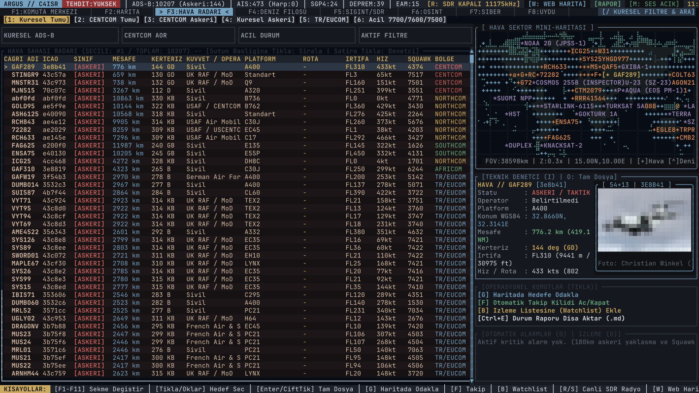
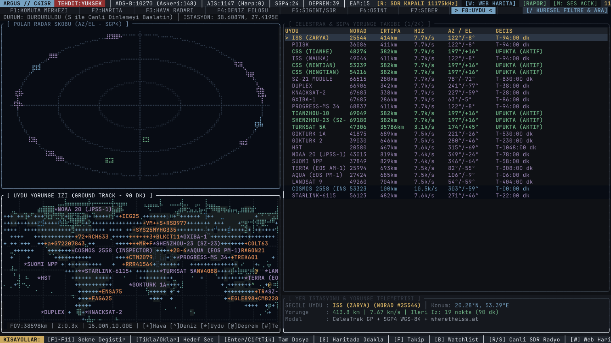

<div align="center">

# Project Sentinel (`argus-osint`)

**Gerçek Zamanlı Çoklu Disiplinli C4ISR OSINT, SIGINT & Taktik Durumsal Farkındalık İstasyonu**

[](https://github.com/NothingManTR/project-sentinel/actions/workflows/ci.yml)


*ADS-B Hava Radarı • AIS Deniz Trafiği • KiwiSDR HF Radyo & DFT Şelalesi • CelesTrak SGP4 Uydular • USGS/Kandilli/EMSC Sismik • NASA FIRMS Termal • Safecast CBRN • CISA/IODA/Shodan Siber • K-1 Denizaltı Kabloları • K-4 Çapraz Alan Füzyonu • Canlı OSINT DEFCON • Yerleşik Gemini AI SITREP*

</div>

---

**Project Sentinel (`argus-osint`)**, Rust (`ratatui v0.29` + `tokio`) ile geliştirilmiş terminal tabanlı (ve eşzamanlı yerel Web Harita sunucusuna sahip) bütünleşik bir **C4ISR Durumsal Farkındalık ve Açık Kaynak İstihbarat (OSINT / SIGINT)** konsoludur.

> **Sıfır Sentetik Veri Prensibi:** Sistemde yapay hedef, sahte log veya simülasyon üretilmez. Tüm telemetri doğrudan kamuya açık küresel veri akışlarından, WebSocket yayınlarından, gerçek `KiwiSDR` kısa dalga alıcılarından ve opsiyonel resmi API anahtarlarından beslenir.

---

## İçindekiler

- [Ekran Görüntüleri](#ekran-görüntüleri)
- [Öne Çıkan Yetenekler (8 İstihbarat Disiplini + AI + Füzyon)](#öne-çıkan-yetenekler)
- [Çalışma Alanı Mimarisi (`Workspace`)](#çalışma-alanı-mimarisi)
- [Veri Kaynakları ve API Gereksinimleri](#veri-kaynakları-ve-api-gereksinimleri)
- [Kurulum, Yapılandırma ve Çalıştırma](#kurulum-yapılandırma-ve-çalıştırma)
- [Klavye, Fare ve Harita Katmanı Kontrolleri](#klavye-fare-ve-harita-katmanı-kontrolleri)
- [Testler ve Doğrulama](#testler-ve-doğrulama)
- [Lisans](#lisans)

---

## Ekran Görüntüleri

### 1. Komuta Merkezi (`F1`)
> 3 sütunlu operasyon kokpiti: Natural Earth haritası + yakınlık radarı, canlı HFGCS EAM / SGP4 / USGS / OSINT / CISA akışları, OSINT `DEFCON` rozeti, seçili hedef teknik denetçisi ve terminal içi canlı uçak fotoğrafı (`Sixel` / `Halfblocks`).


### 2. Küresel Vektör & Raster Harita (`F2`)
> Resmî **Natural Earth** `1:50m` küresel kıyılar, ülke sınırları ve göller + `1:10m` bölgesel detaylar + `720x360` kara/deniz maskesi üzerinde K-1 denizaltı fiber kabloları (`[ :Kablo]`), 300 KiwiSDR alıcısı (`[ :SDR]`), platform şekilli uçaklar (`P`) ve K-4 füzyon kümeleri (`[x:Fuz]`).


### 3. Küresel & CENTCOM Hava Sahası Radarı (`F3`)
> Çok kaynaklı ADS-B (`opendata.adsb.fi`, `api.adsb.lol`, 20 bölgeli küresel mozaik + `OpenSky`), AOR sınıflandırması (`CENTCOM`, `TR/EUCOM`, `AFRICOM`, `INDOPACOM`, `NORTHCOM`, `SOUTHCOM`), askeri/ISR sezgisel tespiti, GPS jamming (`NIC < 5`) ve mini-harita korelasyonu.



### 4. Gerçek Zamanlı KiwiSDR HF Radyo & DFT Spektrum Şelalesi (`F5`)
> `rx.linkfanel.net` üzerinden 300 canlı `0–30 MHz` KiwiSDR alıcısı, `/SND` WebSocket canlı PCM ses akışı, 60-bin Ayrık Fourier Dönüşümü (DFT) şelalesi, opsiyonel Bant Tarayıcı (`T`), VOX Oto-WAV (`X`), ITU CW Morze Çözücü (`C`) ve `eam.watch` HFGCS EAM akışı.


### 5. CelesTrak SGP4 Uydu Polar Radar Skobu (`F8`)
> CelesTrak GP TLE verilerinden anlık `sgp4` yörünge propagasyonu (`ISS`, `Tiangong`, `Göktürk`, `Türksat`, `NOAA`, `Starlink` vb.), Azimuth/Elevation polar radar skobu, 90 dakikalık yer izi ve AOS/LOS geçiş sayacı.



---

## Öne Çıkan Yetenekler

### Genel Komuta, OSINT DEFCON & Yapay Zeka (`Gemini AI SITREP`)
- **Canlı OSINT DEFCON Rozeti:** Üst banttaki statik etiket yerine `defconlevel.com` ve `pizzint.watch` üzerinden gerçek zamanlı **DEFCON 1..5** durumu gösterilir; rozete tıklanınca `CENTCOM`, `EUCOM`, `INDOPACOM`, `AFRICOM` gibi komutanlık bazlı kırılım açılır.
- **Yerleşik Gemini AI Taktik Durum Raporu (`[AI:SITREP]` / `Shift+A` / `Ctrl+A`):** Tüm aktif sensörlerden toplanan canlı telemetriyi (`DEFCON`, `Watchlist` & Alarmlar, seçili hedef + A-2 rota bilgisi, AOR dağılımı + Acil Squawk + en yakın/anomalili `25` askeri uçuş, `15` deniz hedefi, GPS-JAM bölgeleri, parkur anomalileri, K-4 füzyon kümeleri, ufuk üstü ve yakın geçişli `15` SGP4 uydu, KiwiSDR + DSP tarama/CW + `10` HFGCS EAM, `12` deprem, NASA FIRMS VIIRS `15` sıcak nokta, Safecast CBRN, NOAA uzay havası, OpenWeatherMap istasyon/bölge hava durumu, CISA KEV / IODA / Shodan, ACLED çatışma ve `15` OSINT haber) tek bir yapılandırılmış bağlamda Gemini Interactions API'ye (`v1beta/interactions`) göndererek Türkçe karar destek SITREP raporu üretir.
  - Varsayılan model `gemini-3.8-flash` olup, sunucu yoğunluğu veya kısıt (`HTTP 503 / 429 / 404`) durumunda otomatik olarak `gemini-3.6-flash` → `gemini-3.5-flash-lite` → `gemini-flash-lite-latest` yedek zincirine geçer ve `[ E: Not Defterine Aktar ]` ile raporu doğrudan taktik not defterine kaydeder.
- **Taktik Markdown Dışa Aktarım (`Ctrl+E` / `[Rapor]`):** Anlık tüm konsol durumunu `sentinel_report_*.md` dosyasına kaydeder.

### Coğrafi İstihbarat & Çapraz Alan Füzyonu (`GEOINT` — `F2` & Web Harita)
- **Çift Motorlu Harita:** Terminal içinde `HalfBlockTerrain`, `HalfBlockDarkTile`, `HalfBlockSatellite` (`topo_tiles.bin`, `dark_tiles.bin`, `sat_tiles.bin`) ve `BrailleVector` (`Natural Earth 1:50m & 1:10m`) modları (`V` ile geçiş) + tarayıcıda `http://127.0.0.1:8090` adresinde canlı **Canvas Leaflet Web Haritası** (`W`).
- **K-1 Denizaltı Fiber Kabloları (`[ :Kablo]`):** TeleGeography (`submarinecablemap.com`) küresel denizaltı fiber kablo omurgaları hem TUI haritasında hem de Web Haritada (`/api/cables`) çizilir.
- **K-4 Çapraz Alan Füzyonu & Anomali Motoru (`[x:Fuz]`):** Hedef iz geçmişinden askeri dairesel `ORBIT / REFUEL-CAP` yörüngelerini ve AIS `LOITERING` / `>65kt` anomalilerini otomatik tespit eder; mekânsal olarak örtüşen farklı istihbarat alanlarını (`AIR + SEA + GEO + FIRMS + JAM`) puanlı `FusionCluster` kriz kümelerinde birleştirir.
- **Platform Şekli Modu (`P` / `[ :Sekil]`):** Uçakları çağrı adı metni yerine platform sınıfı/gövde tipine göre geometrik sembollerle (`▲` Jet/Savaş, `✦` ISR/AWACS, `◈` Tanker/Kargo, `❖` Helikopter, `◆` Geniş Gövde, `▴▸▾◂` Dar Gövde, `▫` Hafif) gösterir.

### Hava & Deniz İstihbaratı (`AIRINT` `F3` & `SEAINT` `F4`)
- **Çok Kaynaklı Küresel ADS-B:** `opendata.adsb.fi`, `api.adsb.lol`, `opensky` ve küresel 20-bölge mozaiği; otomatik AOR sınıflandırması, askeri/tanker/ISR tespiti, Acil Squawk (`7500/7600/7700`) alarmları ve GPS Jamming (`NIC < 5`) çıkarımı.
- **A-2 Uçuş Rotası & Büyük Daire Yayı:** Seçili uçak için opsiyonel `FlightAware AeroAPI` veya anahtarsız ücretsiz `hexdb.io` üzerinden kalkış/varış havalimanı ve ETA sorgulanır; TUI haritası üzerinde kalkış → uçak → varış büyük daire yayı çizilir.
- **Canlı Uçak Fotoğrafı (`Inspector` & `T-Dossier`):** `Planespotters.net` + `hexdb.io` tescil/gövde bilgileri `ratatui-image` ile doğrudan terminal içinde (`Sixel` / `Halfblocks`) görüntülenir.
- **AIS Deniz Trafiği (`F4`):** `AISStream` WebSocket (`10.000` gemi kapasitesi), MID bayrak devleti çözümlemesi, harp/sahil güvenlik ayrımı ve Türk Boğazları / Süveyş / Babülmendep / Hürmüz stratejik geçit alarmları.

### Sinyal İstihbaratı (`SIGINT` — `F5`)
- **Canlı KiwiSDR WebSocket (`/SND`) Ses & DFT Şelalesi:** 300 açık KiwiSDR kısa dalga alıcısı (`0–30 MHz`), `USB`/`LSB`/`AM`/`CW` modları (`U`), serbest kHz girişi (`F`), oto-devreye giren alıcı kilidi (`L`), canlı `.wav` kayıt (`V`), `S-Meter` dBm + medyan tabanlı SNR dB ölçümü.
- **MEGA-C Opsiyonel DSP Modülleri (Varsayılan Kapalı):**
  - `T`: **Otonom HF Bant Tarayıcı** (belirlenen kritik frekansları SNR eşiğiyle tarar ve yakalanan yayınları listeler)
  - `X`: **VOX Oto-WAV Kaydedici** (aktif ses/sinyal tespitinde `recordings/vox_*.wav` altına otomatik kayıt)
  - `C`: **600 Hz Çoklu-Bin Goertzel CW Morze Çözücü** (`5–40 WPM` dinamik hız kestirimli ITU Morze kod çözümü)
- **Haritada 300 SDR Alıcısı (`[ :SDR]`):** Harita üzerinde `&` simgelerine tek tıkla doğrudan alıcı değiştirme.

### Uydu, Jeofizik, Siber ve Donatılar (`F6`–`F11`)
- **OSINT (`F6`) & Siber (`F7`):** Küresel kriz RSS akışları, CISA KEV aktif istismar kataloğu, IODA BGP/İnternet kesintileri ve `Shodan` / `InternetDB` hızlı IP/port/CVE keşfi.
- **SATINT (`F8`):** CelesTrak TLE + SGP4 yörünge hesaplayıcı, polar skop ve yörünge izi.
- **MASINT (`F9`):**
  1. **Sismik (`USGS`, `Kandilli`, `EMSC`):** Canlı küresel ve Türkiye odaklı deprem ağı.
  2. **Termal (`NASA FIRMS`):** `VIIRS_NOAA20_NRT` öncelikli (+ `VIIRS_SNPP_NRT` yedekli) Doğu Akdeniz, Türkiye, Karadeniz, Kafkaslar ve Orta Doğu sıcak nokta akışı.
  3. **CBRN & Hava (`Safecast`, `NOAA SWPC`, `A-3 OpenWeatherMap`):** Çevresel radyasyon ölçümleri, Kp/G-fırtına/X-Ray uzay havası ve `[ :Meteo]` harita katmanı.
- **Taktik Donatılar (`F10`–`F11`):** `notes.txt` kalıcı taktik not defteri (`F10`) ve havacılık/deniz/radyo birim çeviricili hesap makinesi (`F11`).

---

## Çalışma Alanı Mimarisi

```text
argus-osint/
├── crates/
│   ├── argus-core/       # Ortak veri modelleri, AppState, RingBuffer, config, K-4 füzyon & anomali motoru
│   ├── argus-ingest/     # Asenkron veri toplayıcılar (ADS-B, AIS, KiwiSDR/DSP, SGP4, DEFCON, K-1/A-2/A-3, Gemini)
│   └── argus-tui/        # Ratatui C4ISR TUI görünümleri (F1-F11), Natural Earth harita, Inspector/Dossier, Axum Web Harita
├── docs/screenshots/     # Güncel TUI ekran görüntüleri
├── config.example.toml   # Örnek yapılandırma şablonu
└── Cargo.toml            # Workspace bağımlılık tanımları
```

| Crate | Başlıca Modüller |
| :--- | :--- |
| **`argus-core`** | `config.rs`, `fusion.rs`, `geo.rs`, `mouse.rs`, `state.rs`, `theme.rs`, `types.rs` |
| **`argus-ingest`** | `opensky.rs`, `aisstream.rs`, `kiwisdr.rs`, `sigint_dsp.rs`, `eam_sigint.rs`, `celestrak.rs`, `usgs_seismic.rs`, `nasa_firms.rs`, `safecast_radiation.rs`, `noaa_space.rs`, `weather_owm.rs`, `subsea_cables.rs`, `airspace_warnings.rs`, `flight_schedule.rs`, `aircraft_photo.rs`, `defcon_osint.rs`, `news_wire.rs`, `cisa_kev.rs`, `ioda_outages.rs`, `shodan.rs`, `acled.rs`, `gemini_intel.rs` |
| **`argus-tui`** | `app.rs`, `ui.rs`, `web_map.rs`, `views/{dashboard,geoint,air_tracks,sea_tracks,sigint,osint,cyberint,satint,masint,notepad,calculator}.rs`, `widgets/{p100_map,inspector,dialog,table,shodan_panel}.rs` |

---

## Veri Kaynakları ve API Gereksinimleri

Proje **hiçbir API anahtarı olmadan da** ana istihbarat modüllerinin büyük bölümüyle tam çalışır; opsiyonel anahtarlar ek veri katmanlarını ve AI analizini açar.

### Anahtarsız Çalışan Canlı Kaynaklar
| Disiplin | Kaynak | Kapsam |
| :--- | :--- | :--- |
| **AIRINT** | `opendata.adsb.fi`, `api.adsb.lol`, `OpenSky`, `hexdb.io`, `Planespotters.net` | Küresel ADS-B uçuşlar, AOR sınıflandırması, uçak rotası özeti & fotoğraf |
| **SIGINT** | `rx.linkfanel.net` (`KiwiSDR` 300 alıcı), `eam.watch` | Canlı 0–30 MHz WebSocket ses/şelale, EAM & SKYKING mesajları |
| **SATINT** | `CelesTrak` GP TLE, `live.ariss.org`, `amsat.org` | `sgp4` anlık uydu yörüngeleri ve geçiş tahminleri (`40` uydu) |
| **ÇATIŞMA** | `GDELT v2` 15-dk CAMEO (`lastupdate.txt`) | Anahtarsız canlı küresel silahlı çatışma/saldırı olayları (ACLED yedeği) |
| **DEFCON / GEOINT** | `defconlevel.com`, `pizzint.watch`, `submarinecablemap.com` | Canlı OSINT DEFCON seviyesi & K-1 denizaltı fiber kablo haritası |
| **MASINT** | `USGS`, `Kandilli`, `EMSC`, `Safecast`, `NOAA SWPC` | Canlı deprem ağı, radyasyon sensörleri ve güneş/uzay havası |
| **CYBER / OSINT** | `CISA KEV`, `IODA`, `Shodan InternetDB`, Kriz RSS Akışları | Bilinen istismarlar, BGP kesintileri, temel IP sorgusu, haber akışı |

### Opsiyonel API Anahtarları (`config.toml` & Ortam Değişkenleri)

| Özellik | `config.toml` (`[api_keys]`) | Ortam Değişkeni | Nereden Alınır? |
| :--- | :--- | :--- | :--- |
| **Gemini AI SITREP** | `gemini_key`, `gemini_model` *(varsayılan: `gemini-3.8-flash`)* | `ARGUS_GEMINI_KEY` *(veya `GEMINI_API_KEY`)*, `ARGUS_GEMINI_MODEL` | https://aistudio.google.com/ (Ücretsiz katman mevcut) |
| **NASA FIRMS VIIRS** | `nasa_firms_key` | `ARGUS_FIRMS_KEY` | https://firms.modaps.eosdis.nasa.gov/api/map_key/ (Ücretsiz) |
| **OpenWeatherMap (A-3)** | `openweather_key` | `ARGUS_OPENWEATHER_KEY` | https://home.openweathermap.org/api_keys (Ücretsiz katman) |
| **AISStream Deniz (SEAINT)** | `aisstream_key` | `ARGUS_AISSTREAM_KEY` | https://aisstream.io/ (Ücretsiz WebSocket anahtarı) |
| **Shodan Tam Tarama** | `shodan_key` | `ARGUS_SHODAN_KEY` | https://account.shodan.io/ *(Anahtar yoksa InternetDB çalışır)* |
| **FlightAware AeroAPI (A-2)** | `flightaware_key` | `ARGUS_FLIGHTAWARE_KEY` | https://www.flightaware.com/aeroapi/portal *(Yoksa `hexdb.io` çalışır)* |
| **ACLED Çatışma Verisi** | `[acled]` → `email`, `password` | `ARGUS_ACLED_EMAIL`, `ARGUS_ACLED_PASSWORD` | https://developer.acleddata.com/ *(Yoksa/403'te `GDELT v2` çalışır)* |

---

## Kurulum, Yapılandırma ve Çalıştırma

### Sistem Gereksinimleri (Linux)
- **Rust Toolchain:** `rustc` & `cargo` (1.80+ önerilir)
- **Ses & Derleme Paketleri:**
  - **Arch Linux:** `sudo pacman -S alsa-lib pkgconf`
  - **Debian / Ubuntu:** `sudo apt install libasound2-dev pkg-config build-essential`

### 1. Depoyu Klonlama ve Yapılandırma
```bash
git clone https://github.com/NothingManTR/project-sentinel.git
cd project-sentinel
cp config.example.toml config.toml
```

[config.example.toml](config.example.toml) şablonunu referans alarak `config.toml` içine yalnızca kullanmak istediğiniz opsiyonel anahtarları ekleyin (`config.toml` dosyası `.gitignore` içerisindedir, repoya gönderilmez):

```toml
[station]
callsign = "ARGUS-STATION"
name = "Istanbul Tactical OSINT Node"
default_lat = 41.0082
default_lon = 28.9784
auto_ip_location = true

[api_keys]
shodan_key = ""
aisstream_key = ""
nasa_firms_key = ""
gemini_key = ""
gemini_model = "gemini-3.8-flash"
openweather_key = ""
flightaware_key = ""
```

### 2. Derleme ve Çalıştırma
```bash
cargo build --release
./target/release/argus-osint
```

> **İpucu:** Canlı uçak fotoğraflarını yüksek çözünürlüklü görmek için `Sixel` destekli bir terminal (örneğin `foot`, `wezterm`, `kitty`) kullanabilirsiniz; desteklemeyen terminallerde veya `tmux` içinde otomatik olarak `Halfblocks` moduna geçer.

---

## Klavye, Fare ve Harita Katmanı Kontrolleri

### Genel Navigasyon & Komutlar
| Tuş / Etkileşim | İşlev |
| :--- | :--- |
| **`F1` – `F11`** | Modüller arası geçiş (`Özet`, `Harita`, `Hava`, `Deniz`, `SIGINT`, `OSINT`, `Siber`, `Uydu`, `MASINT`, `Not`, `Araç`) |
| **`?` / `F12`** | Tam klavye kısayolları ve yardım penceresi |
| **`Shift+A` / `Ctrl+A` / `[AI:SITREP]`** | Çok modlu **Gemini AI Analiz Aracını** aç (`1`: Küresel Flashpoint, `2`: Seçili Hedef, `3`: Bölgesel Kriz, `4`: Özel Soru, `R`: Yenile); üretilen raporlar `reports/` altına otomatik kaydedilir |
| **`K` / `Ctrl+S` / `H` / `E`** *(Diyalogda)* | Açık AI raporunu/dosyayı `reports/*.md` kaydet (`K`/`Ctrl+S`), karanlık tema **HTML Brifing Paketi** üret (`H`), `notes.txt` içine ekle (`E`) |
| **`Ctrl+E` / `[Rapor]`** | Anlık konsol raporunu `sentinel_report_*.md` olarak kaydet |
| **`/`** | Küresel arama ve filtreleme |
| **`W` / `[Web]`** | Tarayıcıda canlı `http://127.0.0.1:8090` Leaflet Web Haritasını aç |
| **`I` / `Z`** | Sağ Teknik Denetçi panelini aç/kapat / Aktif paneli büyüt-küçült |
| **Üst `DEFCON` Rozeti (Tık)** | Komutanlık bazlı canlı OSINT DEFCON dökümünü aç |
| **`Q` / `Esc`** | Diyaloğu kapat veya uygulamadan çık |

### Harita & Hedef Kontrolleri (`F1` / `F2` / Mini-Harita)
- **Fare:** Sol tık sürükle (`Pan`), fare tekerleği veya `+`/`-` (`Zoom`), hedefe tek tık (`Denetçi`), çift tık veya `Enter`/`O` (`Fotoğraflı Tam Dosya`).
- **`G` / `F` / `B`:** Haritada Odakla / Otomatik Takip Kilidi / Watchlist Ekle-Çıkar.
- **`V` / `P`:** Harita render stili değiştir (`Topo`, `Gece`, `Arazi`, `Vektör`) / Uçakları platform şekliyle göster (`[ :Sekil]`).
- **Üst Katman Düğmeleri:** `[x:Air]`, `[x:Sea]`, `[x:Sat]`, `[x:Fire]`, `[x:Geo]`, `[ :SDR]`, `[ :Kbl]` *(K-1)*, `[ :Met]` *(A-3)*, `[x:Fuz]` *(K-4)*, `[ :Ntm]` *(N-4 NOTAM/SIGMET/GPS-JAM Çokgenleri)*.
- **Bölge Hızlı Odak:** `[TR]`, `[IST]`, `[D.Akd]`, `[Krdnz]`, `[CENT]`, `[Dunya]`.

### SIGINT (`F5`), MASINT (`F9`) & Notlar/Arşiv (`F10`) Kontrolleri
- **`F5` SIGINT:** `S` (Canlı KiwiSDR Ses Aç/Kapat), `1`–`9` (HF Ön Ayar Frekansları), `F` (Serbest kHz Girişi), `U` (Mod: `USB`/`LSB`/`AM`/`CW`), `L` (Oto-Alıcı Kilidi), `V` (`.wav` Kayıt), `T` (Bant Tarayıcı), `X` (VOX Oto-Kayıt), `C` (CW Morze Çözücü), `Tab` (Alıcı/EAM Odağı), `N` (Sonraki Alıcı).
- **`F9` MASINT:** `1` Depremler, `2` NASA FIRMS Termal, `3` Safecast CBRN & NOAA Uzay Havası.
- **`F10` Notlar & AI Rapor Arşivi:** `Tab` (Sol Dosya Arşivi `notes.txt` + `reports/*.md/*.html` ↔ Sağ Editör), `Ok`/`PgUp`/`PgDn`/Tekerlek (Kaydır & Dosya Seç), `Ctrl+S` (Kaydet), `Ctrl+N` (Yeni `.md` Not), `Ctrl+T` (Seçili Hedefi Ekle), `Ctrl+H` (HTML Brifing), `F5` (UTC Zaman Damgası), `Ctrl+D`/`Delete` (Arşiv Dosyası Sil).

---

## Testler ve Doğrulama

```bash
# Statik analiz (uyarılar hata sayılır)
cargo clippy --all-targets -- -D warnings

# Çevrimdışı birim testleri (harici canlı ağ testleri hariç)
cargo test --workspace -- --skip test_live_ --skip test_celestrak_ --skip test_cisa_ --skip test_ioda_ --skip test_aisstream_ --skip test_safecast_
```

---

## Güvenlik ve Gizlilik
- `config.toml` içerisinde yer alan API anahtarları **yalnızca yerel makinenizde** tutulur ve `.gitignore` ile sürüm kontrolü dışında bırakılır.
- Gemini AI analiz özelliği (`[AI:SITREP]`), yalnızca kullanıcı açıkça tetiklediğinde (`Shift+A` / `Ctrl+A` / buton tıkı) o anki canlı telemetri özetini Gemini API'ye gönderir; arka planda otomatik veri gönderimi yapmaz.

## Lisans

Bu proje [MIT Lisansı](LICENSE) ile lisanslanmıştır.
